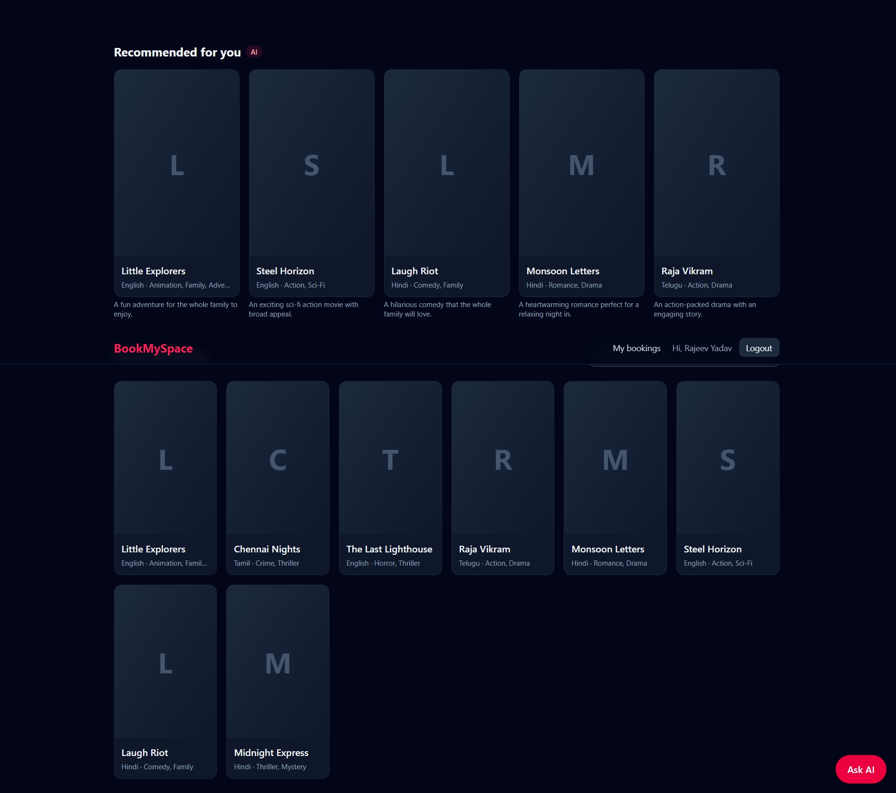
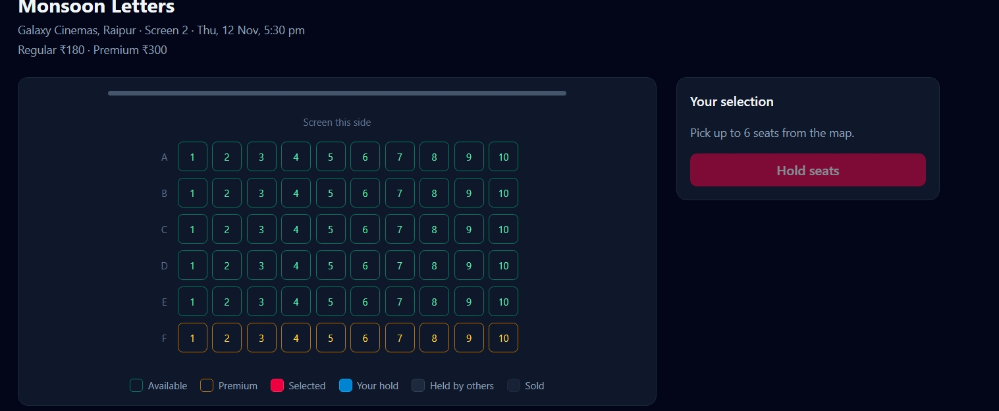
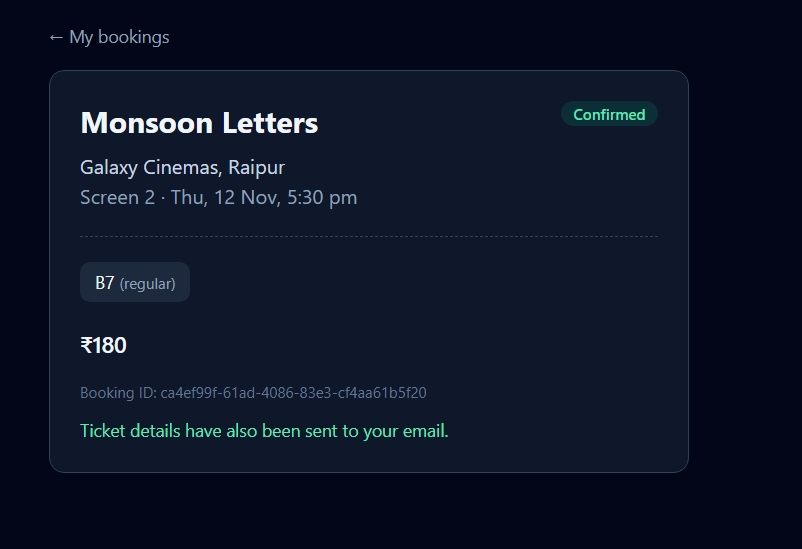
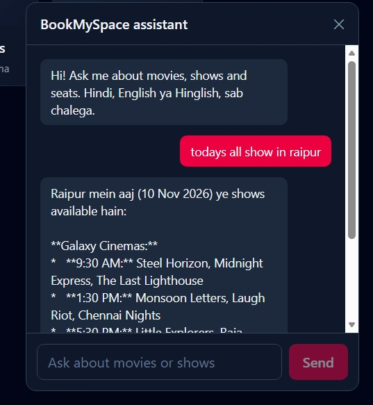
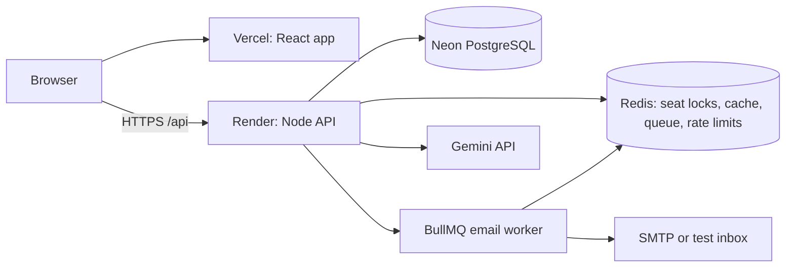

# BookMySpace

A full stack movie ticket booking platform (BookMyShow style) with concurrency safe seat booking, a payment flow, background jobs and an AI assistant.

**Live demo:** https://book-my-space-zeta.vercel.app
**API health:** https://bookmyspace-uqeu.onrender.com/api/health

> Demo notes: the app runs on free hosting tiers, so the first load can take up to a minute while the server wakes up. Payments run in **demo mode** (no real money is used). Ticket emails go to a test inbox.

## Screenshots

| Home | Seat map with hold timer |
|---|---|
|  |  |

| Ticket | AI assistant |
|---|---|
|  |  |

## Features

- Browse movies, search, and filter shows by city and date
- Interactive seat map with live status (available, held, booked) and a hold countdown
- 5 minute seat hold, extended while paying, released automatically on expiry
- Payment flow with signature verification, webhook handling and automatic refunds
- Booking history, ticket page and cancellation (up to 2 hours before the show)
- Ticket emails sent by a background worker with retries and backoff
- AI assistant that answers from live data using tool calling, plus personalised recommendations
- JWT authentication, role based access (user and admin), rate limiting

## Tech stack

| Layer | Technology |
|---|---|
| Frontend | React, Vite, Tailwind CSS, React Router |
| Backend | Node.js, Express, zod, JWT, bcrypt |
| Database | PostgreSQL (plain SQL migrations) |
| Cache, locks, queue | Redis, BullMQ |
| AI | Gemini through an OpenAI compatible API, tool calling |
| DevOps | Docker, docker compose, GitHub Actions |
| Hosting | Vercel (frontend), Render (API), Neon (PostgreSQL), Render Key Value (Redis) |

## Architecture



More detail, including the booking sequence, data model and failure handling, is in [docs/system-design.md](docs/system-design.md).

## Key engineering decisions

- **No double booking.** Seats are locked in Redis with an atomic Lua script (all seats or none, with a TTL). PostgreSQL has a partial unique index on active seat bookings, so even if Redis fails, two people can never hold the same seat.
- **No overlapping shows.** A PostgreSQL exclusion constraint stops two shows from overlapping on the same screen.
- **Safe payments.** The amount is always calculated on the server. Payment signatures are verified with HMAC. Verify and webhook can both arrive and the booking is still created once. If a seat is lost, the payment is refunded.
- **AI with guardrails.** The assistant only has read only tools, tool inputs are validated like user input, and every user has a rate limit. If the AI is down, recommendations fall back to a simple scoring function.

## Run locally

Requirements: Node.js 22 and Docker.

```bash
# 1. Start PostgreSQL and Redis
docker compose up -d

# 2. Backend
cd backend
cp .env.example .env     # fill JWT_SECRET, and set PAYMENT_MODE=mock
npm install
npm run migrate
npm run seed             # demo movies, theatres, screens and shows
npm run dev

# 3. Frontend (new terminal)
cd frontend
npm install
npm run dev
```

Open http://localhost:5173. To make a user an admin, update the `role` column in the `users` table.

To run the whole stack in containers:

```bash
cp backend/.env.docker.example backend/.env.docker   # fill JWT_SECRET
docker compose -f docker-compose.full.yml up -d --build
```

Open http://localhost:8080.

## Tests and CI

```bash
cd backend && npm test     # needs PostgreSQL and Redis running
cd frontend && npm test
```

GitHub Actions runs backend tests against real PostgreSQL and Redis service containers, runs the frontend tests and build, and builds both Docker images on every push.

## Project structure

```
backend/
  migrations/        SQL migrations
  src/
    config/          env, database, redis
    middlewares/     auth, validation, rate limit, errors
    modules/         auth, movies, theatres, shows, booking, payments, ai
    jobs/            queue, mailer
    db/              migrate and seed scripts
frontend/
  src/
    api/             API client
    components/      seat map, chatbot, recommendations
    pages/           home, movie, seats, bookings, login
docs/                system design and screenshots
```

## API overview

| Area | Endpoints |
|---|---|
| Auth | `POST /api/auth/register`, `POST /api/auth/login`, `GET /api/auth/me` |
| Movies | `GET /api/movies`, `GET /api/movies/:id` (admin: create, update, delete) |
| Theatres | `GET /api/theatres`, `GET /api/theatres/:id` (admin: create theatre and screens) |
| Shows | `GET /api/shows`, `GET /api/shows/:id` returns the seat map (admin: create) |
| Bookings | `POST /api/bookings/hold`, `DELETE /api/bookings/hold/:id`, `GET /api/bookings`, `GET /api/bookings/:id`, `POST /api/bookings/:id/cancel` |
| Payments | `POST /api/payments/order`, `POST /api/payments/verify`, `POST /api/payments/webhook` |
| AI | `POST /api/ai/chat`, `GET /api/ai/recommendations` |
| Ops | `GET /live`, `GET /api/health` |

`POST /api/bookings/confirm` exists for demo mode only and is disabled when real payments are on.

## Known limitations

- The payment gateway is implemented behind an interface and tested with a mock gateway. It has not been tested against a live Razorpay account, because account activation needs business KYC documents. The hosted demo uses mock payments.
- Free hosting means cold starts, and the free Redis instance can lose data on restart. Seat locks may reset, but the database still prevents double booking.
- Emails use a test inbox, not a real mail provider.
- There is no admin UI yet. Admins use the API.
- The seat map refreshes by polling every 10 seconds, not by WebSockets.
- The auth token is kept in localStorage. httpOnly cookies would be safer.