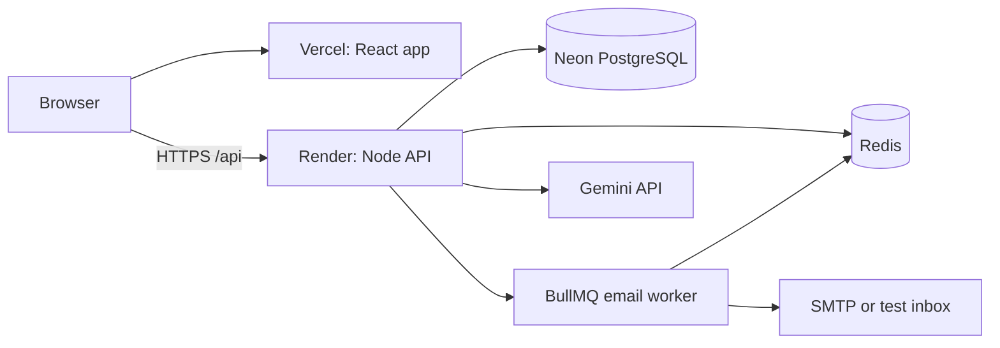
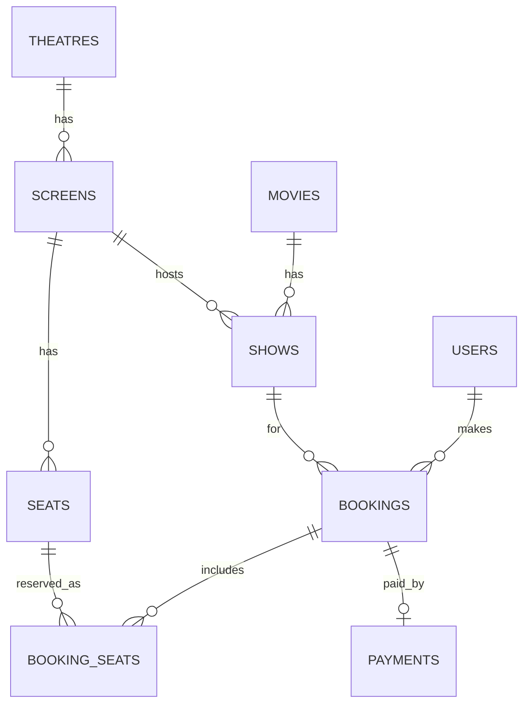
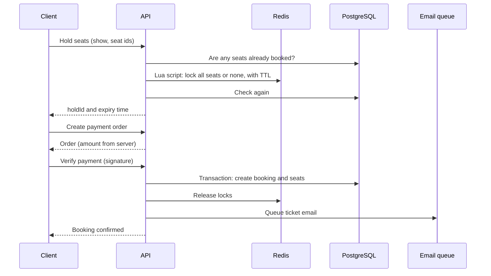
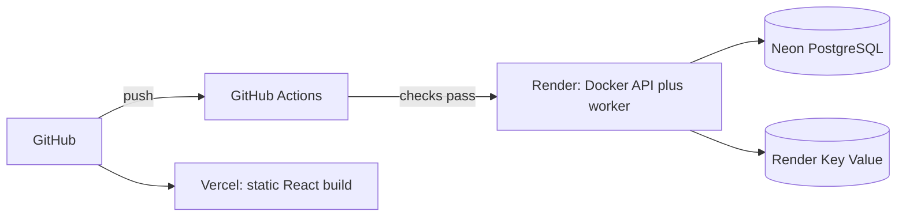

# System Design: BookMySpace

## 1. Requirements

**Functional**
- Browse movies and shows, view a live seat map
- Select seats, hold them temporarily, pay, receive a ticket
- Cancel a booking and get a refund
- Ask an AI assistant about movies, shows and seats

**Non functional**
- Correctness first: a seat must never be sold twice
- Responsive seat selection under many users
- Safe to retry: duplicate requests must not create duplicate bookings
- Degrade gracefully when Redis, email or the AI provider is down

## 2. Architecture

| Component | Responsibility |
|---|---|
| React app | UI, seat map, hold timer, payment popup |
| Node API | Business rules, validation, auth, rate limits |
| PostgreSQL | Source of truth for users, shows, bookings, payments |
| Redis | Seat locks with TTL, cache, job queue, rate limit counters |
| Worker | Sends ticket emails with retries (runs inside the API process on free hosting) |
| Gemini | Chat answers and recommendations |

The API is stateless (state lives in PostgreSQL and Redis), so it can be scaled by adding instances.

## 3. Data model

Constraints that protect correctness:

| Constraint | Protects against |
|---|---|
| Partial unique index on `booking_seats (show_id, seat_id) WHERE is_active` | Two active bookings for one seat |
| Exclusion constraint on `shows (screen_id, time range)` | Two shows overlapping on one screen |
| Unique `bookings.hold_id` | Same hold turning into two bookings |
| Unique open payment per hold | Two open orders for one hold |
| `CHECK` constraints on status, price and duration | Invalid data |

Money is stored as `NUMERIC` and calculated in integer paise in code.

## 4. Booking flow

Three layers protect a seat:

1. **Redis lock (speed).** An atomic Lua script checks and sets every seat in one step. If any seat is taken, nothing is locked. The lock has a TTL, so abandoned holds free themselves.
2. **Check, lock, check again.** The database is read before and after the lock, so a booking that lands between the two steps is still caught.
3. **Database unique index (truth).** Even if Redis loses its data, inserting a second active booking for the same seat fails.

## 5. Failure scenarios

| Scenario | What happens |
|---|---|
| Two users click the same seat together | One gets the lock, the other gets a 409 and the seat map refreshes |
| Redis restarts and locks vanish | The unique index still blocks double booking. A user may see an expired hold and pick again |
| Redis is down | The seat map still loads. New holds fail (the system fails closed). Rate limiting and caching are skipped |
| User pays but the hold expired and the seat was sold | The booking is not created and the payment is refunded automatically |
| Browser closes right after payment | The webhook creates the booking |
| Verify and webhook both arrive | Only one booking is created (unique `hold_id` and an atomic status update) |
| Same confirm sent twice | The second call returns the same booking |
| Cancel clicked twice | Row lock in a transaction, the second call returns 409 |
| Email provider fails | Job retries with exponential backoff. The booking is not affected |
| AI provider is busy | Tries the next model. Recommendations fall back to scoring. Chat returns a clear error |
| Server receives a stop signal | Stops accepting requests, finishes running ones, closes the queue, database and Redis |

## 6. Payments

- The amount is calculated from the server side hold, never from the client.
- Payment signatures are verified with HMAC and a timing safe compare.
- The webhook route reads the raw body, because the signature is computed on the exact bytes.
- A payment row moves through `created, paid, refund_pending, refunded, refund_failed`. Each move is an atomic `UPDATE ... WHERE status = ...`, so two requests cannot both win.
- The gateway sits behind an interface. A mock gateway is used for tests and for the hosted demo.

## 7. Caching, rate limiting and queues

| Feature | Design |
|---|---|
| Movie cache | Cache aside, 60 seconds for lists and 5 minutes for one movie. Cleared by prefix when an admin changes a movie. If Redis fails, the database is used |
| Rate limits | Redis counters per user or IP. Global limit, a stricter limit on login and register, and separate hourly limits for AI endpoints |
| Email queue | BullMQ with 5 attempts, exponential backoff and a job id per booking so duplicates are not queued |

## 8. AI design

- The assistant uses **tool calling**. Three read only tools (search movies, find shows, check availability) return live data, so answers come from the database and not from the model's memory.
- Tool inputs from the model are validated with the same schemas as user input. Tool results are treated as data, not instructions.
- The agent loop has a maximum number of steps.
- Recommendations use a **forced function call** to get a fixed JSON shape. Returned movie ids are checked against the candidate list, so invented ids are dropped.
- The provider layer uses an OpenAI compatible API and a list of fallback models, so changing provider is a config change.
- Cost controls: per user hourly limits, token limits per call, caching of recommendations and token usage logging.

## 9. Deployment

- Migrations run at API startup under a PostgreSQL advisory lock, so two instances never migrate together.
- Production refuses to start with missing or weak configuration (short JWT secret, missing CORS origin, demo payments without an explicit flag).
- Docker images use multi stage builds and run as a non root user.
- Liveness (`/live`) and readiness (`/api/health`) are separate endpoints.

## 10. Scaling path

| Bottleneck | Next step |
|---|---|
| API CPU | Run more API instances behind a load balancer. The API is stateless |
| Database reads | Read replicas for movie and show queries, longer caching |
| Seat map polling | Server sent events or WebSockets to push seat changes |
| Hot shows (big releases) | Queue users before seat selection (virtual waiting room) |
| Email volume | Run the worker as its own service and scale it separately |
| Data growth | Partition `shows` and `bookings` by date, archive old shows |

## 11. Trade offs and next steps

- Redis locks give speed, the database gives safety. Using only one of them would be either slow or unsafe.
- Polling every 10 seconds is simple and cheap, but not instant.
- Free hosting causes cold starts and an unreliable Redis, which is fine for a demo and not for production.

Next steps: admin dashboard, a real payment gateway with live testing, a real email provider, metrics and tracing, end to end tests with Playwright, and httpOnly cookie authentication.